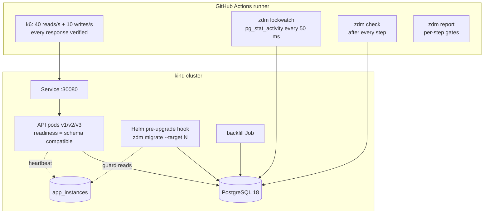

# zero-downtime-migrations

[](https://github.com/ahmedelgmal310/zero-downtime-migrations/actions/workflows/ci.yml)
[](LICENSE)

Shipping a **breaking database schema change** and three app releases on Kubernetes with
**zero failed requests**. A Go API on PostgreSQL splits `name` into `first_name` /
`last_name` with the **expand → migrate → contract** pattern:

- Migrations run as a **Helm pre-upgrade hook Job** with `lock_timeout` and `statement_timeout`,
  and retry when a lock is not available.
- The backfill is a **batched, throttled Kubernetes Job**.
- A **fleet guard** refuses the destructive step while old code is still running.
- A **migration linter** (squawk) blocks unsafe DDL in CI. A negative test proves that it does.

Every push to `main` re-proves the claim on a throwaway **kind** cluster under continuous
**k6** load (reads + writes). The run covers rolling upgrades v1 → v2 → v3, every migration,
and a **rollback from v2 to v1 while the backfill is running**. The job fails unless every
step has **0 failed requests**, **p95 under the SLO**, and **passing data consistency
checks** (row counts and checksums).

## Contents

- [The problem](#the-problem)
- [Expand / migrate / contract timeline](#expand--migrate--contract-timeline)
- [How it works](#how-it-works)
- [Results from CI](#results-from-ci)
- [Negative tests: what gets blocked](#negative-tests-what-gets-blocked)
- [Design decisions](#design-decisions)
- [Limitations](#limitations)
- [Runbook: shipping a breaking schema change safely](#runbook-shipping-a-breaking-schema-change-safely)
- [Repository layout](#repository-layout)
- [Local development](#local-development)

## The problem

A rolling update runs the **old and the new release at the same time**. A rollback brings
the old release back after the new one has written data. So a schema change that only works
with the new code breaks requests at some point during the rollout, and a "fast" DDL can
still cause an outage:

| Change | What goes wrong under traffic |
|---|---|
| `ALTER TABLE users RENAME COLUMN name TO full_name` | every pod still on the old release fails at once |
| `ALTER TABLE users DROP COLUMN name` in the same release as the code change | the old pods that are still draining fail (shown in the [demo job](#negative-tests-what-gets-blocked)) |
| `ADD COLUMN ... DEFAULT gen_random_uuid()` | full table rewrite under `ACCESS EXCLUSIVE`: all reads and writes block |
| `CREATE INDEX` without `CONCURRENTLY` | writes block for the whole index build |
| any DDL without `lock_timeout` | the DDL queues behind one long query, and every new query queues behind the DDL |

The fix is a sequence of **backward-compatible steps**. At every moment, each release that
can be running (including the one you might roll back to) works with the current schema.

## Expand / migrate / contract timeline

```mermaid
flowchart LR
  S1["<b>1 · v1</b><br/>schema: name"]
  S2["<b>2 · v1 → v2</b><br/>+ first_name, last_name (nullable)<br/>+ sync trigger · index CONCURRENTLY<br/>v2 dual-writes, reads name"]
  S3["<b>3 · backfill Job</b><br/>1000-row batches, 200 ms pause"]
  S4["<b>rollback v2 → v1</b><br/>backfill keeps running<br/>trigger fills split columns<br/>for v1 writes"]
  S5["<b>4 · v1 → v2</b><br/>roll forward"]
  S6["<b>5 · backfill done</b><br/>0 NULL rows"]
  S7["<b>6 · v2 → v3</b><br/>reads + writes first/last only<br/>trigger keeps name for rollback"]
  S8["<b>7 · contract</b><br/>CHECK NOT VALID → VALIDATE → SET NOT NULL<br/>drop trigger + name"]
  S1 -->|"pre-upgrade hook<br/>EXPAND 00002, 00003"| S2 --> S3
  S3 -.->|helm rollback| S4 -.-> S5 --> S6 --> S7
  S7 -->|"pre-upgrade hook<br/>guard: no v1/v2 alive<br/>CONTRACT 00004-00006"| S8
```



What each release reads and writes, and which schema phases it supports:

| Release | Writes | Reads | Baseline (`name`) | Expanded (both) | Contracted (split only) |
|---|---|---|:-:|:-:|:-:|
| v1 | `name` | `name` | yes | yes (the trigger derives the split columns) | **no** (this is why the contract is guarded) |
| v2 | `name`, `first_name`, `last_name` (dual write) | `name` | no (pod stays unready) | yes | no |
| v3 | `first_name`, `last_name` | `first_name`, `last_name` | no (pod stays unready) | yes (the trigger derives `name` for a rollback) | yes |

The public API is the same in every release: clients send and receive a full `name`. Only
the storage behind it changes. This is what lets old and new pods serve the same traffic.

## How it works



**One binary, three releases.** [`cmd/zdm`](cmd/zdm) is the API server, the migration Job,
the backfill Job and the e2e tooling. The release (`v1`, `v2`, `v3`) is baked in at build
time (`-ldflags -X main.version=v2`), so each release is an immutable image tag, the same as
three consecutive deploys. The data access for each release is in
[`internal/store`](internal/store/store.go).

**Migrations** ([`migrations/`](migrations)) are plain SQL in goose format and are embedded
in the binary. The Helm hook Job ([`charts/zdm/templates/migration-job.yaml`](charts/zdm/templates/migration-job.yaml))
runs `zdm migrate --target N` **before** Kubernetes creates the new ReplicaSet. If the Job
fails, Helm aborts the upgrade and the running pods are untouched. The migrator
([`internal/migrate`](internal/migrate/migrate.go)):

- sets `lock_timeout=1s` and `statement_timeout=2m` on every session. Each file also sets
  them itself, and the linter enforces that;
- applies one version at a time and **retries on `lock_timeout`** with backoff (10
  attempts). A transactional migration rolls back cleanly, so a retry is safe. The
  `CONCURRENTLY` index migration drops a possibly `INVALID` leftover index first;
- takes a Postgres advisory lock, so two migrators never run at once;
- **never migrates down**. A target below the current version is a no-op, so `helm rollback`
  only rolls back the app. The schema stays expanded, and the old release tolerates that.

**The expand step** ([`00002`](migrations/00002_expand_split_name.sql)) adds nullable columns
without defaults (a metadata-only change) and a `BEFORE INSERT OR UPDATE` trigger. The
trigger keeps both representations in sync whoever writes: v1 (also after a rollback)
writes only `name`, v3 writes only the split columns. The split rule is the same in Go
([`internal/names`](internal/names/names.go)), in the trigger and in the backfill, and a test
checks SQL against Go on edge cases (`"Mary Ann Smith"`, `"Cher"`, double spaces, non-ASCII).

**The backfill** ([`internal/backfill`](internal/backfill/backfill.go)) walks the primary
key in ranges of 1000. Each batch is its own short transaction with `SET LOCAL lock_timeout`
and `statement_timeout`, and each batch is followed by a 200 ms pause. Rows that already
have `first_name` are skipped, so the Job is idempotent: it can be killed, re-applied or run
again after a rollback. It is rendered from the chart but applied **outside the Helm
release**, because a `helm rollback` would otherwise delete a running backfill.

**The contract step** ([`00004`](migrations/00004_names_not_null_check.sql)–[`00006`](migrations/00006_contract_drop_name.sql))
uses the safe `NOT NULL` sequence (`CHECK ... NOT VALID`, then `VALIDATE` under
`SHARE UPDATE EXCLUSIVE`, then `SET NOT NULL`, which uses the validated check and skips the
scan). Then it drops the trigger and `name`. Before `00006` the migrator reads the **fleet
registry**: every API pod heartbeats its release into `app_instances` every 5 s and removes
itself on graceful shutdown. If any `v1` or `v2` instance heartbeated in the last 20 s, the
migrator refuses and the Helm upgrade fails. The registry is in the database, not the
Kubernetes API, so it also covers writers outside the cluster, and the Job needs no RBAC.

**Pods never serve a schema they cannot handle.** Readiness is tied to the schema. A pod
checks `information_schema` for the columns its release needs and stays unready until they
exist. So deploying v2 before the expand migration stalls the rollout instead of failing
requests. Rolling updates use `maxUnavailable: 0`, a native `preStop` sleep while the pod
leaves the endpoints, and an in-app drain. After `SIGTERM` the server disables keep-alives
for 3 s, so clients reconnect to a pod that is not shutting down, then it shuts down
gracefully. Queries list their columns explicitly: `SELECT *` would break cached prepared
statements in running pods when a column is added or dropped.

**Measurement.** k6 runs on the runner against the NodePort (kind port mapping) for the
whole scenario. Every request is logged with its timestamp, latency, status, a body
check and the `X-App-Version` of the pod that answered. Reads must return the exact
deterministic name of a seeded id, and writes must echo the name and return a new id.
[`scripts/e2e.sh`](scripts/e2e.sh) records the step timeline.
[`zdm report`](internal/report) slices the request log into steps and evaluates the gates.
`zdm lockwatch` samples `pg_stat_activity` every 10 ms for queries waiting on a lock. API
queries are told apart from migrator and backfill sessions by `application_name`.
`zdm check` runs after every step.

## Results from CI

These numbers come from CI run
[#40726656392](https://github.com/ahmedelgmal310/zero-downtime-migrations/actions/runs/40726656392)
on `main`: kind v0.33.0, Kubernetes v1.36.4, PostgreSQL 18.6, three API replicas, 200,000
seeded users, and k6 at a constant 40 reads/s + 10 writes/s for the whole scenario.
Each run uploads its own numbers as the `e2e-results` artifact and posts them in the job
summary. The tables below are copied from that run's `report.md`.

### Load and latency per step

| Step | Duration | Requests (reads / writes) | Failed | p50 | p95 | p99 | max | Served by |
|---|---:|---:|---:|---:|---:|---:|---:|---|
| 1. v1 steady state | 30 s | 1507 (1205 / 302) | **0** | 0.8 ms | 1.2 ms | 1.7 ms | 12.7 ms | v1 100% |
| 2. expand migration + rolling update v1→v2 | 37 s | 1851 (1481 / 370) | **0** | 0.8 ms | 1.8 ms | 3.9 ms | 10.9 ms | v1 40% · v2 60% |
| 3. backfill running + **rollback v2→v1** | 34 s | 1704 (1363 / 341) | **0** | 0.8 ms | 1.7 ms | 4.0 ms | 10.9 ms | v1 48% · v2 52% |
| 4. roll forward v1→v2 | 34 s | 1701 (1361 / 340) | **0** | 0.9 ms | 1.7 ms | 3.7 ms | 13.8 ms | v1 48% · v2 52% |
| 5. backfill completes | 5 s | 270 (216 / 54) | **0** | 0.8 ms | 1.4 ms | 2.1 ms | 3.7 ms | v2 100% |
| 6. rolling update v2→v3 | 38 s | 1879 (1503 / 376) | **0** | 0.9 ms | 1.7 ms | 3.3 ms | 11.3 ms | v2 40% · v3 60% |
| 7. contract migration (guarded) | 23 s | 1170 (936 / 234) | **0** | 0.8 ms | 1.4 ms | 2.9 ms | 7.6 ms | v3 100% |
| 8. v3 steady state (contracted) | 20 s | 1001 (801 / 200) | **0** | 0.8 ms | 1.3 ms | 2.0 ms | 11.5 ms | v3 100% |
| **whole run** | 221 s | **11229 (8982 / 2247)** | **0** | 0.8 ms | 1.5 ms | 3.3 ms | 13.8 ms | |

"Served by" is the `X-App-Version` header of the responses. It shows that old and new
pods really served the same traffic during each rolling update and during the rollback.
Latency is client-observed, including connection setup. The SLO gate is p95 ≤ 100 ms per
step. The worst step was 1.8 ms.

### Migrations, backfill and locks

| Migration (hook Job) | Release step | Duration | Attempts |
|---|---|---:|---:|
| `00002_expand_split_name` (2 nullable columns + sync trigger) | 2 | 9.1 ms | 1 |
| `00003_index_users_last_name` (`CREATE INDEX CONCURRENTLY`, 200k rows) | 2 | 74.4 ms | 1 |
| `00004_names_not_null_check` (`CHECK ... NOT VALID`) | 7 | 4.4 ms | 1 |
| `00005_names_set_not_null` (`VALIDATE` + `SET NOT NULL`) | 7 | 21.8 ms | 1 |
| `00006_contract_drop_name` (guard passed: only `v3=3` alive) | 7 | 3.0 ms | 1 |

| Backfill | Value |
|---|---|
| Rows converted | 200,329 in 201 batches of 1000 |
| Duration / throughput | 42.6 s, **4,703 rows/s** (throttled by a 200 ms pause per batch) |
| Slowest batch | 46.1 ms |
| Lock-timeout retries | 0 |
| Rows still to convert when the rollback to v1 finished | 41,329 (the Job kept running through the rollback and the roll-forward) |

| Lock waits | Value |
|---|---|
| API queries seen waiting on a lock (`pg_stat_activity` sampled every 10 ms, all steps) | **none** |
| Lock waits > 100 ms logged by PostgreSQL (`log_lock_waits`, `deadlock_timeout=100ms`) | **0** |

### Data consistency (checked after every step)

| After step | Schema phase | Rows | Seed checksum | name ≠ split | Not backfilled |
|---|---|---:|---|---:|---:|
| seeded | baseline | 200000 | `734de17fe2c7` | 0 | 0 |
| 2. expand + v1→v2 | expanded | 200691 | `734de17fe2c7` | 0 | 200329 |
| 3. rollback v2→v1 (backfill running) | expanded | 201031 | `734de17fe2c7` | 0 | 41329 |
| 5. backfill completes | expanded | 201426 | `734de17fe2c7` | 0 | 0 |
| 7. contract | contracted | 202035 | `734de17fe2c7` | 0 | 0 |
| final (load stopped) | contracted | **202247** | `734de17fe2c7` | 0 | 0 |

The seed checksum is an md5 over `id:full_name` for the 200,000 seeded rows. It is computed
from `name` before the contract and from `first_name`/`last_name` after it. Because it stays
the same, the representation changed without changing a single row's data. After the load
stopped, **202,247 rows = 200,000 seeded + 2,247 acknowledged writes**: every write that got
a `201` is in the table. The k6 totals (11,229 requests, 0 errors, 0 dropped iterations)
match the per-request log. Every gate is enforced by [`zdm report`](internal/report/build.go):

| Gate | Result |
|---|---|
| zero failed requests (status **and** body verified) | pass: 0 of 11229 |
| p95 ≤ 100 ms in every step | pass: worst 1.8 ms |
| consistency check after every step | pass: 9 checks |
| request log matches k6's own totals | pass |
| no dropped iterations (the load generator kept up) | pass |
| every acknowledged write is stored | pass |

Go test coverage in the same run: **90.7%** (gate 80%), with the integration tests running
against a real PostgreSQL 18.

## Negative tests: what gets blocked

**1. The migration linter fails the build on unsafe DDL.** The `migration-lint` job runs
[squawk](https://squawkhq.com) on `migrations/` ([`.squawk.toml`](.squawk.toml)). Every
reviewed exception is a `-- squawk-ignore <rule>` comment with its justification next to it.
[`scripts/test-lint-gate.sh`](scripts/test-lint-gate.sh) then adds each file in
[`testdata/unsafe-migrations/`](testdata/unsafe-migrations), one at a time, as the next
migration. It asserts that the same gate **fails** and names the expected rule:

| Unsafe migration | Blocked by |
|---|---|
| `ADD COLUMN public_id uuid DEFAULT gen_random_uuid()` (table rewrite) | `adding-field-with-default` |
| `CREATE INDEX` without `CONCURRENTLY` (blocks writes) | `require-concurrent-index-creation` |
| `DROP COLUMN name` while old code still runs | `ban-drop-column` |
| `RENAME COLUMN name TO full_name` | `renaming-column` |
| `ALTER COLUMN ... TYPE varchar(100)` (rewrite) | `changing-column-type` |
| `SET NOT NULL` without a validated `CHECK` | `adding-not-nullable-field` |
| `ADD CONSTRAINT ... CHECK` without `NOT VALID` | `constraint-missing-not-valid` |
| DDL without `lock_timeout` / `statement_timeout` | `require-lock-timeout`, `require-statement-timeout` |

If any of them passes the gate, CI fails.

**2. The contract guard refuses to drop a column under old code.** This is asserted in the
Go integration tests ([`internal/migrate`](internal/migrate/migrate_test.go),
[`internal/cli`](internal/cli/cli_test.go)) and on kind in the separate, clearly labelled
**DEMO** job ([`scripts/demo-unsafe.sh`](scripts/demo-unsafe.sh)). From the same CI run:

| Demo step (v1 serving on 3 pods, 50 req/s) | Requests | Failed |
|---|---:|---:|
| 1. v1 steady state | 751 | 0 |
| 2. expand, backfill, `NOT NULL` while v1 runs (all backward compatible) | 533 | 0 |
| 3. contract attempted: **the guard refuses** (`alive: ["v1=3"]`) | 502 | 0 |
| 4. contract **forced** with `--unsafe-skip-guards` | 1001 | **1000** |

The job passes only if both failure modes are reproduced: the guard refuses, and bypassing
it breaks the old release. v1 reads a column that no longer exists, then its pods go unready
and the Service has no endpoints. Without the guard, this incident is one `helm upgrade` away.

## Design decisions

**Why goose (over Atlas or golang-migrate).**
- goose runs plain, reviewable SQL files, so squawk lints exactly what will run.
- It supports `-- +goose NO TRANSACTION` per file, which `CREATE INDEX CONCURRENTLY` needs.
  Every other file runs in its own transaction, so a failed migration rolls back cleanly and
  can be retried.
- It is a Go library. The migrations are embedded in the same binary, and the migrator wraps
  them with what a live-traffic migration needs: per-session timeouts, retry on lock timeout,
  one version at a time, the fleet guard and structured timing logs.

golang-migrate does not wrap files in transactions, and a failed migration leaves the schema
marked "dirty" until someone runs `force` by hand. Atlas is strong at declarative schema
diffing. Here I wanted versioned, hand-ordered SQL, because the expand/contract order *is*
the design, plus an independent open-source linter.

**Why a trigger as well as dual writes.** v2 dual-writes explicitly, but v1 pods are still
running during the v1 → v2 rollout, and they come back after a rollback. Their writes must
still produce valid split columns. Otherwise a row inserted by v1 during the rollback would
be missing from the new representation. The trigger also derives `name` from v3's writes, so
a rollback from v3 stays possible until the contract.

**Why the plain postgres image, not CloudNativePG.** The subject here is the application's
schema lifecycle, not database operations. A single StatefulSet keeps the e2e fast and
deterministic. An operator adds nothing to a migration: it is still a SQL session with the
same locks. In production the same chart runs against CNPG or a managed database. Only
`database.host` and the Secret change.

**Why migrations in a pre-upgrade hook Job, not an init container.** An init container runs
once per pod: three replicas means three concurrent migrators, and a failure crash-loops
pods while the rollout continues. The hook runs once, before the new ReplicaSet exists. A
failure aborts the upgrade and leaves the old pods untouched.

**Why the backfill is not a hook.** It can take a long time and has to keep running through
a rollback. As a hook it would block `helm upgrade`. As a release resource, `helm rollback`
would delete it.

## Limitations

- **Lock waits are measured by sampling.** `pg_stat_activity` sampled every 10 ms catches
  waits of about 10 ms or more, and `log_lock_waits` catches waits over 100 ms. "None" means
  no wait was observed at that resolution, not that no query ever waited a few milliseconds.
  The per-step max latency (≤ 13.8 ms) is the end-to-end upper bound.
- **The table is small (200k rows).** On a 500M-row table, the `CONCURRENTLY` index and
  `VALIDATE` take minutes, and the backfill takes hours. The safety properties are the same:
  no `ACCESS EXCLUSIVE` lock held during a scan, bounded lock queueing, throttled batches.
  The timings here do not extrapolate. Replication lag, which a real backfill throttle should
  watch, is not modelled: there is one instance.
- **The fleet guard trusts heartbeats.** It sees API pods and anything else that registers.
  A writer that never registers (an ad-hoc script, a forgotten cron job) is invisible to it.
  A pod killed without a graceful shutdown blocks the contract for up to 20 s (the freshness
  window), which is the safe direction.
- **The rollback scenario is v2 → v1, before the contract.** A rollback after the contract
  is deliberately impossible (the down step of `00006` is a no-op). Restoring `name` would be
  a new forward migration.
- **One cluster, one database, no connection pooler.** PgBouncer in transaction mode changes
  how session-level `SET` behaves, so the migrator would need a direct connection.
- **CI-sized load (50 req/s on a shared runner).** This proves correctness (zero errors,
  consistent data). It is not a capacity test.

## Runbook: shipping a breaking schema change safely

**Plan the releases.** Each step is its own deploy. Never combine two steps.

1. **Expand.** Add the new structure in a backward-compatible way: nullable columns, no
   volatile defaults, `CREATE INDEX CONCURRENTLY`, constraints `NOT VALID`. Keep both
   representations in sync (dual writes in code, plus a trigger for old writers). Ship it with
   the release that starts dual-writing.
2. **Migrate.** Backfill in batches, then switch reads to the new structure in the next release.
3. **Contract.** Only after every pod of every older release is gone, enforce the constraints
   and drop the old structure. Do it in a release that changes **only** the schema target.

**Before merging a migration:**

```sh
scripts/lint-migrations.sh          # squawk: clean, or a justified squawk-ignore
go test ./internal/migrate/...      # with ZDM_TEST_DSN set: applies every migration on PostgreSQL
```

Every file must set `lock_timeout` and `statement_timeout` (the linter enforces this). Never
use `SELECT *` or `RETURNING *` in application queries.

**Expand and roll out:**

```sh
helm upgrade zdm charts/zdm -n "$NS" --reuse-values \
  --set image.tag=v2 --set migrations.target=3 --wait --timeout 10m
kubectl -n "$NS" logs job/zdm-migrate            # duration_ms and attempts per migration
```

If the hook Job fails, Helm aborts and the old pods keep serving. A typical failure is
`migration_failed` after 10 lock-timeout attempts because a long transaction holds the table.
Find the blocker and retry:

```sql
SELECT pid, now() - xact_start AS age, state, left(query, 80)
FROM pg_stat_activity WHERE xact_start IS NOT NULL ORDER BY age DESC LIMIT 5;
```

**Backfill.** The Job is idempotent: re-apply it at any time, including after a rollback.

```sh
helm template zdm charts/zdm -n "$NS" --set image.tag=v2 --set backfill.enabled=true \
  --set backfill.pause=200ms --show-only templates/backfill-job.yaml | kubectl -n "$NS" apply -f -
kubectl -n "$NS" logs -f job/zdm-backfill        # backfill_progress ... backfill_done rows_per_sec
psql -c "SELECT count(*) FROM users WHERE first_name IS NULL"   # must reach 0
```

If the database struggles, delete the Job, raise `backfill.pause` or lower
`backfill.batchSize`, and apply it again. It continues with the rows that are left.

**Roll back the app** (any time before the contract):

```sh
helm rollback zdm <previous-revision> -n "$NS" --wait
```

No migration runs on rollback, and the expanded schema still works with the previous release.
Let the backfill keep running.

**Contract.** Run it only after the new release is fully rolled out and the backfill reports
0 remaining rows:

```sh
psql -c "SELECT version, count(*) FROM app_instances
         WHERE last_seen > now() - interval '20 seconds' GROUP BY version"   # only v3
helm upgrade zdm charts/zdm -n "$NS" --reuse-values --set migrations.target=6 --wait
```

If the guard refuses (`guard_refused ... alive: [v2=1]`), the upgrade aborts and nothing has
been dropped. Find the old pod, cron job or worker, retire it, and retry. **Never** use
`--unsafe-skip-guards` outside the demo. The DEMO job shows what it does.

## Repository layout

```
cmd/zdm/                     one binary: serve | migrate | backfill | seed | check | lockwatch | report
internal/store/              data access per release (v1 name, v2 dual write, v3 split columns)
internal/migrate/            goose runner: timeouts, lock-timeout retry, advisory lock, contract guard
internal/fleet/              app_instances heartbeat registry used by the guard
internal/backfill/           keyset-batched, throttled, idempotent backfill
internal/check/              consistency checks (phase-aware, seed checksum, row counts)
internal/lockwatch/          pg_stat_activity lock-wait sampler
internal/report/             per-step latency, gates, Markdown/JSON report
internal/serve/, api/        HTTP API, schema-gated readiness, graceful drain
migrations/                  00001 baseline · 00002-00003 expand · 00004-00006 contract
testdata/unsafe-migrations/  migrations the lint gate must reject
charts/zdm/                  Deployment, migration hook Job, backfill Job, Service, PDB
deploy/postgres.yaml         PostgreSQL for the e2e
loadtest/load.js             k6 reads + writes, every response verified
scripts/                     e2e.sh, demo-unsafe.sh, lint-migrations.sh, test-lint-gate.sh
docs/versions.md             every pinned version and digest
```

## Local development

```sh
go test -race ./...                                    # DB tests skip without a database
docker run -d --name pg -e POSTGRES_HOST_AUTH_METHOD=trust -p 5432:5432 postgres:18
ZDM_TEST_DSN='postgres://postgres@localhost:5432/postgres?sslmode=disable' go test -race ./...
scripts/lint-migrations.sh && scripts/test-lint-gate.sh   # needs squawk
```

To run the full scenario on your own kind cluster (needs docker, kind, helm, jq, psql and python3):

```sh
kind create cluster --name zdm --config e2e/kind-config.yaml
for v in v1 v2 v3; do
  docker build --build-arg APP_VERSION=$v -t zdm:$v . && kind load docker-image zdm:$v --name zdm
done
go build -o bin/zdm ./cmd/zdm
K6_IMAGE=grafana/k6:2.3.0 scripts/e2e.sh           # results in e2e-results/
```

## License

[MIT](LICENSE) © 2026 Ahmed Elgamal
